<picture>
  <source media="(prefers-color-scheme: dark)" srcset="https://raw.githubusercontent.com/txarlye/txarlye/output/pacman-contribution-graph-dark.svg">
  <source media="(prefers-color-scheme: light)" srcset="https://raw.githubusercontent.com/txarlye/txarlye/output/pacman-contribution-graph.svg">
  
</picture> 

<h1 align="center">Hi 👋, I'm Carlos!</h1>
<h3 align="center">A passionate AI | VR developer & architect from Spain</h3>

  

  

- 🔭 I’m currently working at [AST](https://ast.aragon.es/)
- 🌱 I’m currently focused on **Artificial Intelligence, Machine Learning and Generative AI**
- 👨‍💻 All of my public projects are available at [https://github.com/txarlye](https://github.com/txarlye)
- 💬 Ask me about **AI, computer graphics and films!**
- 📫 How to reach me **[txarlye@gmail.com](mailto:txarlye@gmail.com)**

<h3 align="left">Connect with me:</h3>

---

<h3 align="center">🌐 Live Projects</h3>

<i>Real products I design, build and run myself. The code is private: these are screenshots and write-ups.</i>

All of them share the same engineering approach: **Python servers with the standard library only**, one **Docker** container per app on my own server, **automated tests + a pentest on every deploy**, SEO-ready pages rendered server-side, and comment/photo moderation with a local **LLM (Ollama)**.

### 🛝 [WallaPark](https://wallapark.es) — *Which park do we go to today?*

  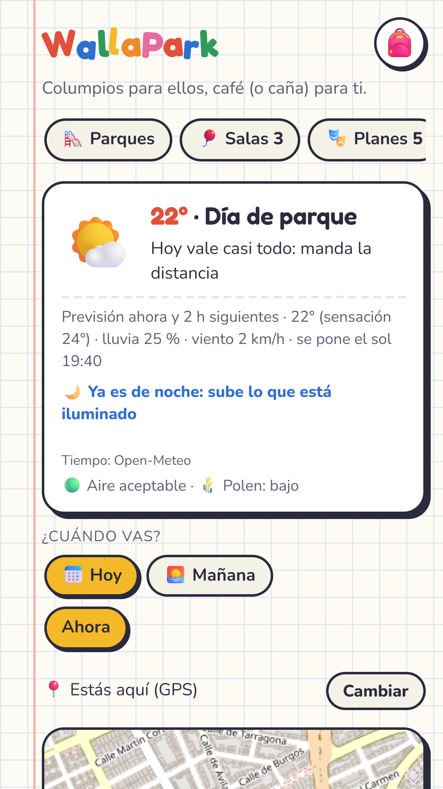
  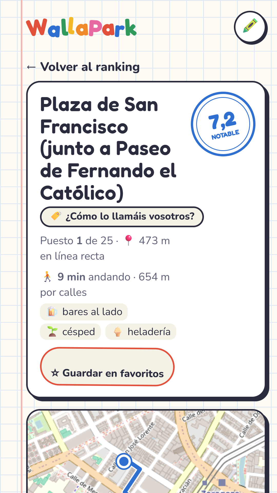
  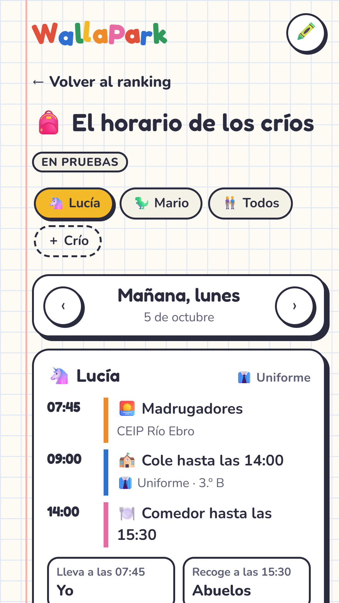

Ranks the nearest playgrounds by **the weather right now** (shade when it's hot, shelter from the wind), bars nearby and what matters to kids and parents. Built on **OpenStreetMap** and **Overture** data for all of Spain, refreshed monthly. Also published as an Android app.
`Python` `Docker` `Leaflet` `OpenStreetMap` `Open-Meteo` · [More →](projects/wallapark.md)

### 🎒 [Palcole](https://palcole.es) — *School life for families*

  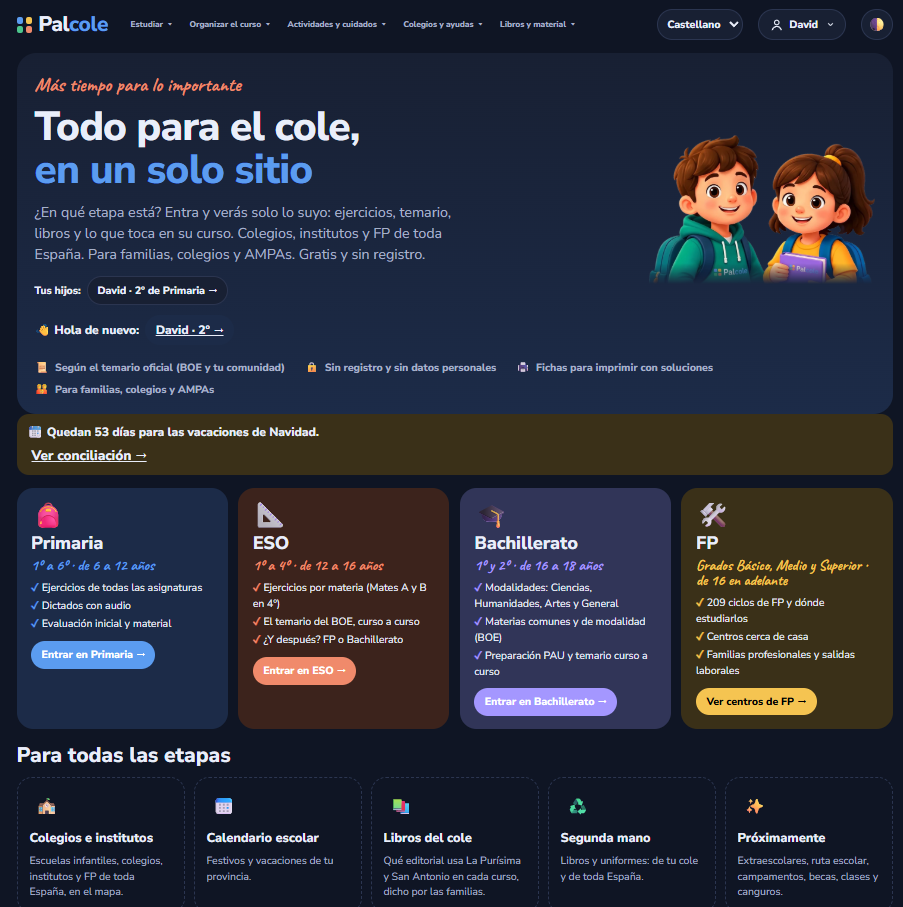

  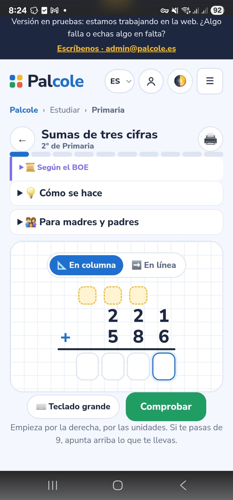
  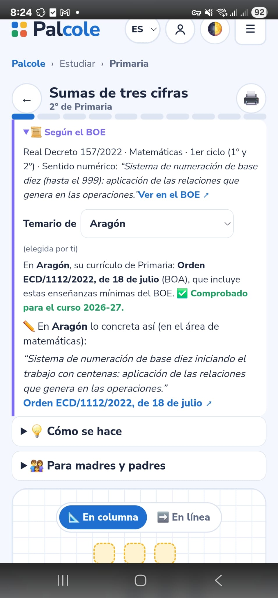
  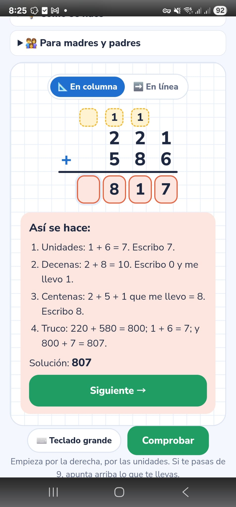

Practice exercises and dictations for each school year, the official curriculum of every region, and a map of the **13,809 schools in Spain** with their plots drawn over aerial photos and their after-school activities. Available in **Spanish, Catalan, Galician and Basque**.
`Python` `Docker` `Leaflet` `i18n` `Open data` · [More →](projects/palcole.md)

### 🍂 [Pafollar](https://pafollar.es) — *Is the countryside at its best this weekend?*

  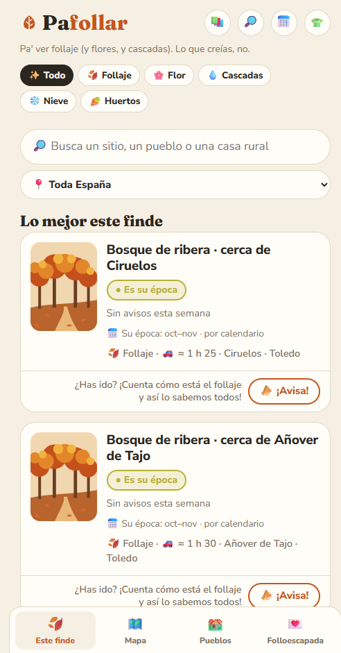
  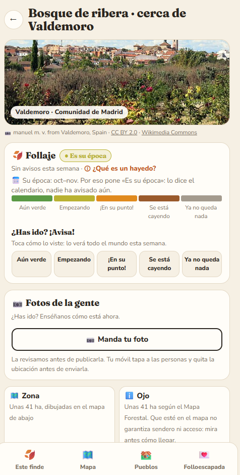
  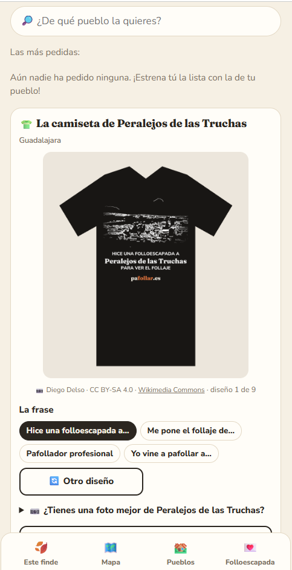

Beech forests in autumn, blossoms, waterfalls with water: people report how each spot looks right now and the app ranks them by that, the weekend forecast, distance and crowds. **Folloescapada** turns it into a trip plan your friends vote on via WhatsApp. *(¿Pafollar? From "follaje", foliage. Mente sucia la tuya 🍂)*
`Python` `Docker` `Leaflet` `Crowdsourcing` · [More →](projects/pafollar.md)

### 🧴 [Pacagar](https://pacagar.es) — *Read the bottle while you're there*

  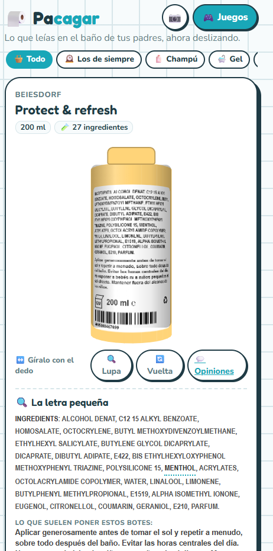
  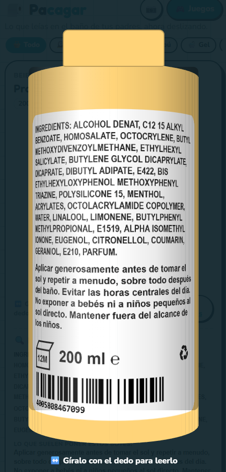
  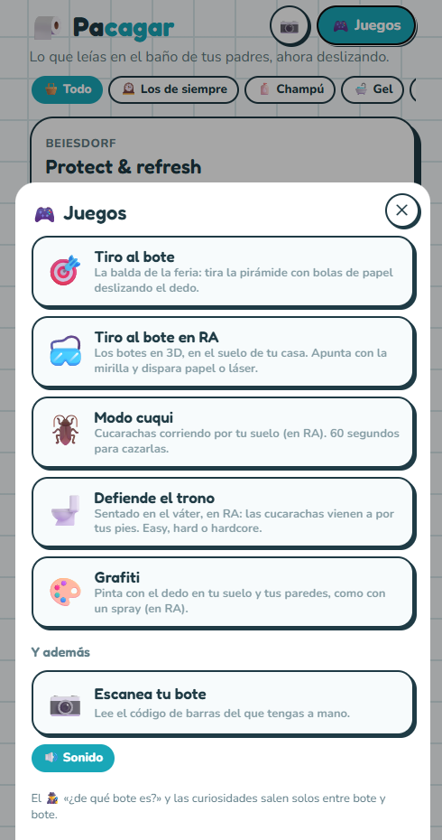

Bathroom products as **3D bottles** you spin to read the label, with every ingredient explained in plain words. Includes **augmented-reality** mini-games and a barcode scanner. Data from Open Beauty Facts, rebuilt monthly.
`Python` `Three.js` `WebXR` `BarcodeDetector` · [More →](projects/pacagar.md)

### ⚡ [Aura Arena](https://auraarena.app) — *Fight with your body, in front of a live crowd* · 📱 Google Play coming soon

  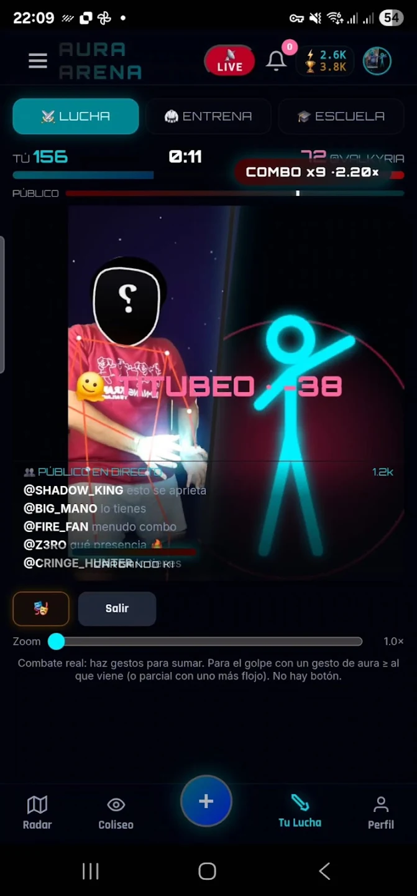
  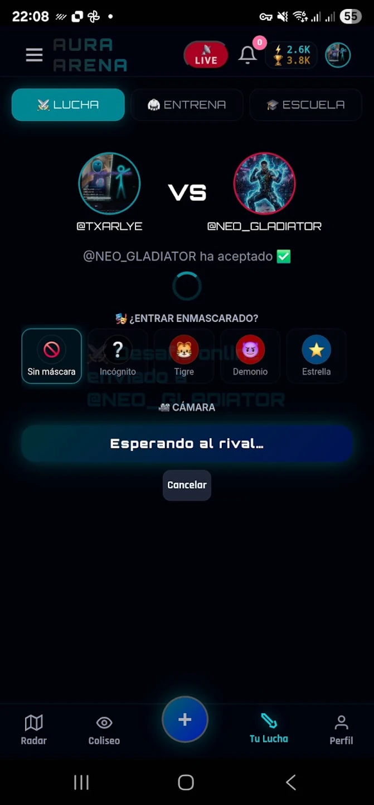
  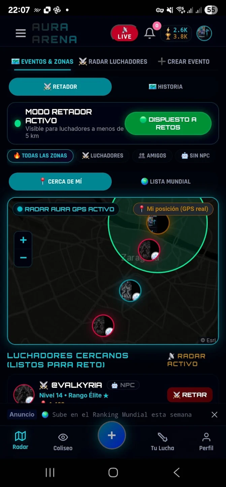

A gesture-based fighting game: your phone's camera tracks your body with **MediaPipe** and your moves become attacks against your rival while the audience votes live. Real-time 1 vs 1 duels, a radar of nearby fighters, and a story mode where you conquer real places. Web app (PWA) plus an **Android app**.
`JavaScript` `MediaPipe` `Node.js` `WebSockets` `WebRTC` `SQLite` `Capacitor` · [More →](projects/aura-arena.md)

### 💼 [Pacurrar](https://pacurrar.es) — *Jobs in Aragón* · 🚧 coming soon
<!-- Screenshots: assets/projects/pacurrar/1.png, 2.png, 3.png -->

Public-sector and private job offers in Aragón and remote, gathered automatically from many sources into one place, with alerts.
`Python` `Docker` `Web scraping` · [More →](projects/pacurrar.md)

---

<h3 align="center">My Pinned Projects</h3>

### 🎮 Game Development Projects (Unity/C# & VR)
* **[The-Cube](https://github.com/txarlye/The-Cube)**
    * **Description:** A 3D platformer and puzzle game developed in Unity. The goal is to navigate complex levels by solving puzzles to reach the goal.
    * **Technologies:** `Unity`, `C#`.

* **[TFM_Utad](https://github.com/txarlye/TFM_Utad)**
    * **Description:** My Master's Thesis. A project developed in Unity focusing on the application and exploration of **Virtual Reality (VR)** environments.
    * **Technologies:** `Unity`, `C#`, `VR`.

* **[Fruit_ninja](https://github.com/txarlye/Fruit_ninja)**
    * **Description:** A functional clone of the popular *Fruit Ninja* game, developed and optimized for Android mobile devices.
    * **Technologies:** `Unity`, `C#`.

---

### 🤖 Artificial Intelligence Projects (Python)
* **[AgentFight](https://github.com/txarlye/AgentFight)**
    * **Description:** A fighting game that uses AI agents to dynamically create characters and fight with them, making every match unique.
    * **Technologies:** `Python`, `Pygame`, `Ollama`, `OpenAI`, `Agents`.

* **[AgentCluedo](https://github.com/txarlye/AgentCluedo)**
    * **Description:** An AI-driven implementation of the classic Cluedo board game. It uses **LangChain** to empower an agent with **LLM-based** reasoning, allowing it to process clues, make logical deductions, and play strategically.
    * **Technologies:** `Python`, `LangChain`.

* **[ia_tradding](https://github.com/txarlye/ia_tradding)**
    * **Description:** An AI project applied to stock market trading. The objective is to analyze market data and make automated buy/sell decisions.
    * **Technologies:** `Python`, `Pandas`, `Scikit-learn`, `Jupyter Notebook`.

---

<h3 align="left">Languages and Tools:</h3>

                             

  

  

