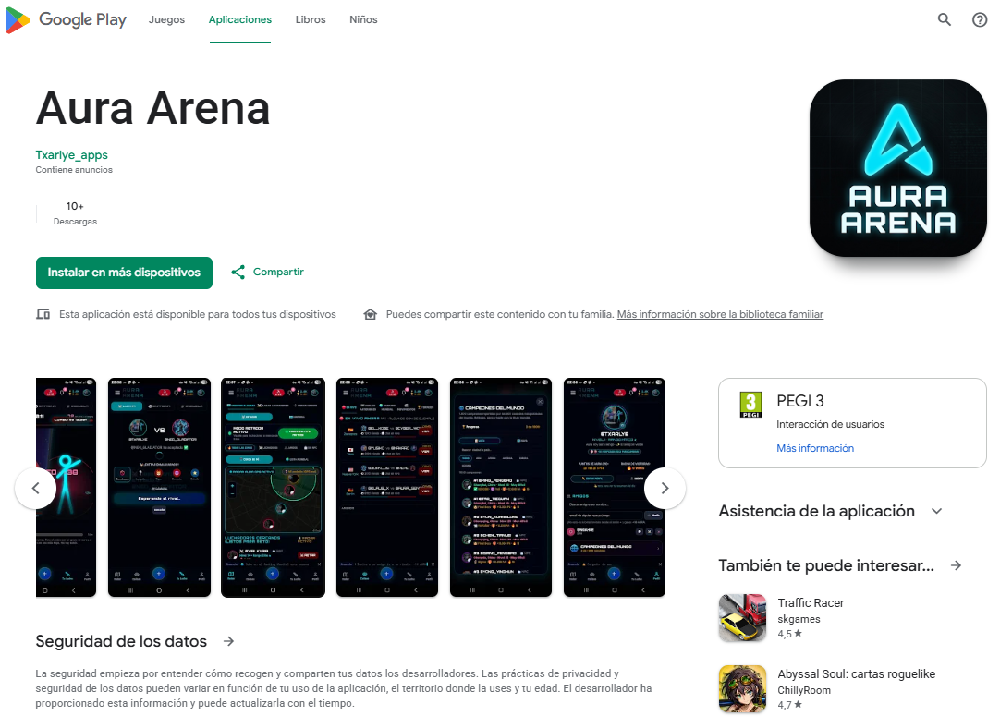
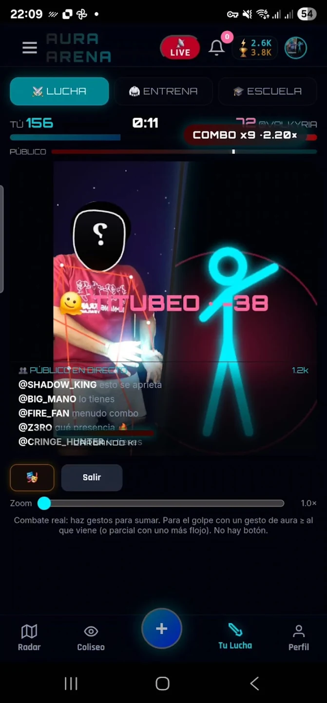
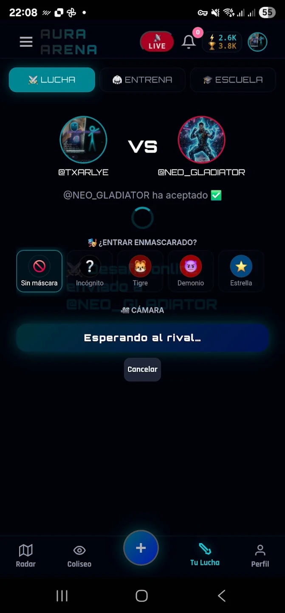
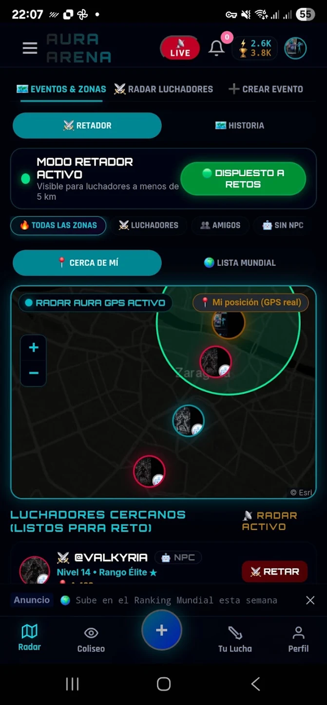
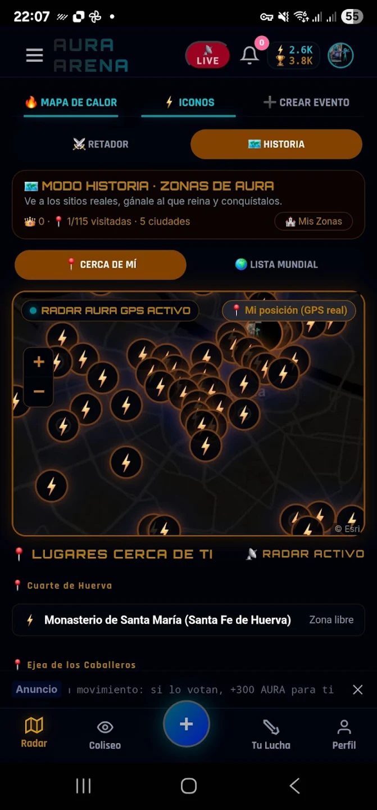

# ⚡ Aura Arena

**[auraarena.app](https://auraarena.app)** · Web (PWA) + Android · 📱 Google Play coming soon · 🔒 Private code

> Fight with your body, in front of a live crowd.

## What it does

- **Gesture fighting:** the camera tracks your body and your moves become attacks against your rival. Block an incoming hit with a gesture of equal or greater aura. There are no buttons.
- **Duels:** real-time 1 vs 1, with matchmaking by level or a direct link or QR code. You can enter with a mask (incognito, tiger, demon, star).
- **Live audience:** the crowd votes and comments as the fight happens.
- **Radar:** fighters near you who are ready for a challenge, and events and tournaments on a map.
- **Story mode, Aura Zones:** go to real places, beat whoever rules each one and conquer it (115 zones in 5 cities).
- **Progression:** ranks from *NPC* to *Aura Sovereign*, training, a skill tree, an in-game economy and a world ranking.
- **Social:** friends, moderated chat and voice.

## Screenshots

  
  
  
  

## How it's built

- **Computer vision:** MediaPipe Tasks Vision models (pose, hands, face and selfie segmentation) running in the browser.
- **Real time:** WebSockets for matches and presence, and WebRTC for peer-to-peer video and voice.
- **Client:** vanilla JavaScript split into single-purpose modules, available in several languages, installable as a PWA.
- **Backend:** Node.js with a deliberately small stack (`ws`, `nodemailer`, `node:sqlite`). Data access goes through repositories, so the app can move to AWS without rewriting its logic.
- **Mobile:** packaged for Android with Capacitor, with AdMob.
- **Quality:** end-to-end test suites run before and after every change.
