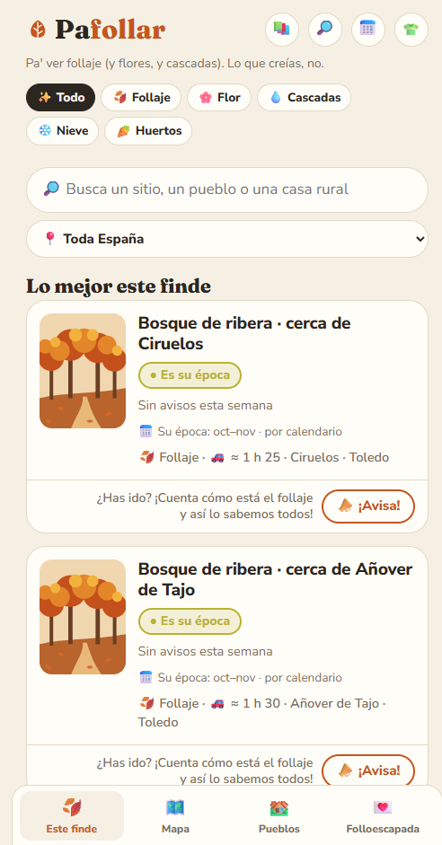
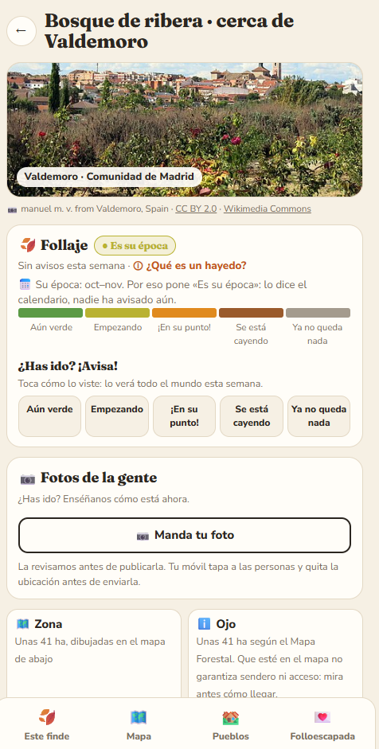
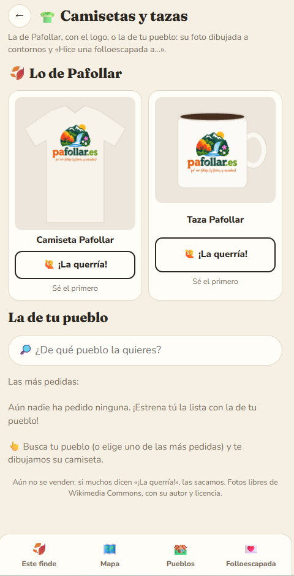
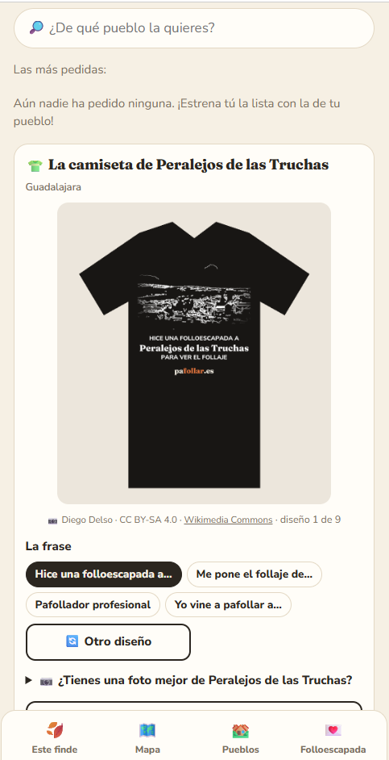

# 🍂 Pafollar

**[pafollar.es](https://pafollar.es)** · Web · 🔒 Private code

> *¿Pafollar? De follaje. Mente sucia la tuya 🍂* ("Pa' ver follaje": to go and see the foliage.)

## What it does

*Where is the countryside at its best this weekend?* Beech forests in autumn, blossoms, waterfalls with water.

- **Reports from people:** each spot is marked as green / starting / at its best / falling / bare.
- **Smart ranking:** combines those reports with the weekend forecast, distance and how crowded each spot gets.
- **Folloescapada:** a trip plan with dates that friends vote on, shared over WhatsApp.
- **Share previews:** a generated image for each spot and status.
- **Towns:** a "town of the month" voted by visitors, and a t-shirt for every town, drawn as outlines from a free Wikimedia Commons photo.
- **Official data:** spots come from Spain's Forest Map, with the area drawn on the map and directions to get there.

## Screenshots

  
  

  
  

## How it's built

- **Backend:** Python with the standard library only, in small single-purpose modules with pure, tested business rules.
- **Data:** a database of Spanish towns and nature spots. The deploy refuses to go out if the data looks broken.
- **Front end:** vanilla JavaScript and Leaflet.
- **Ops:** Docker with a single data volume, so it can move to any host. Photos are moderated with a local LLM, and every feature adds its own checks to the pentest.
