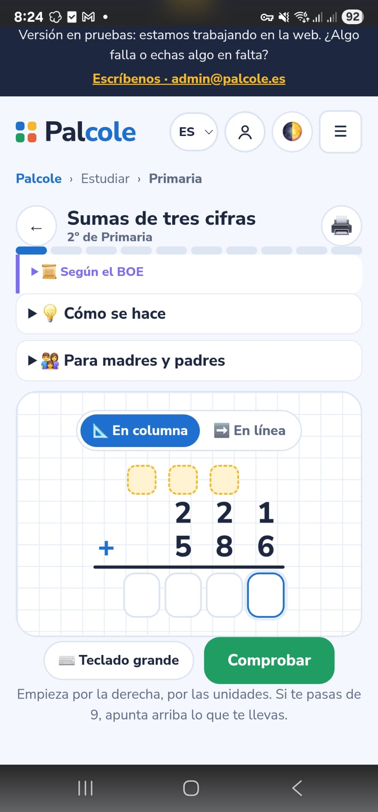
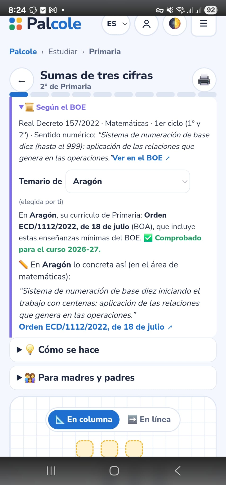
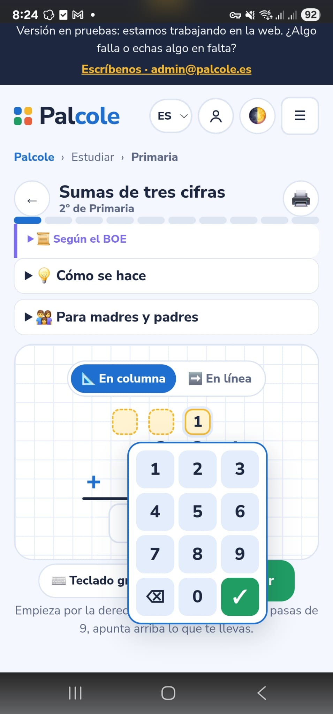
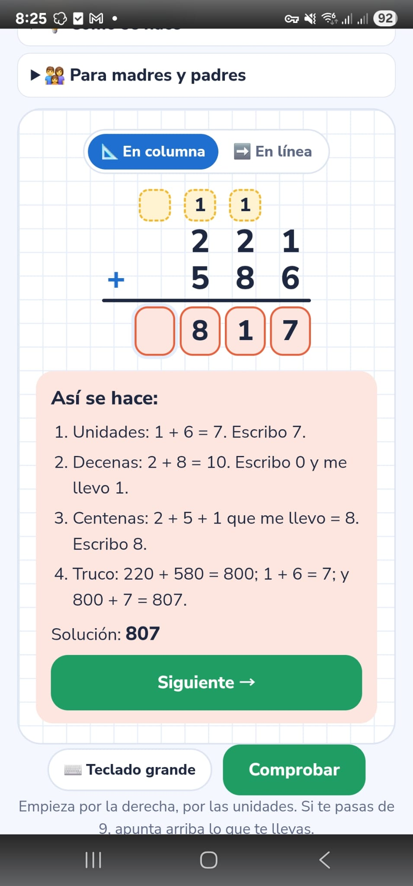
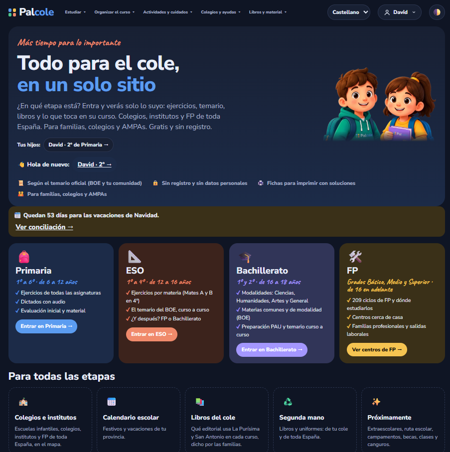
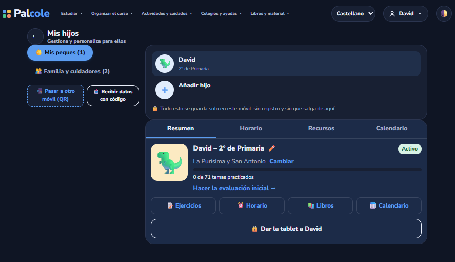
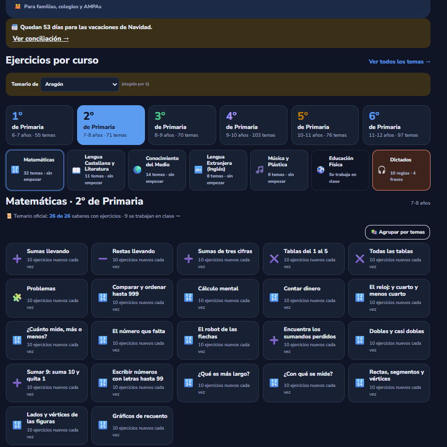
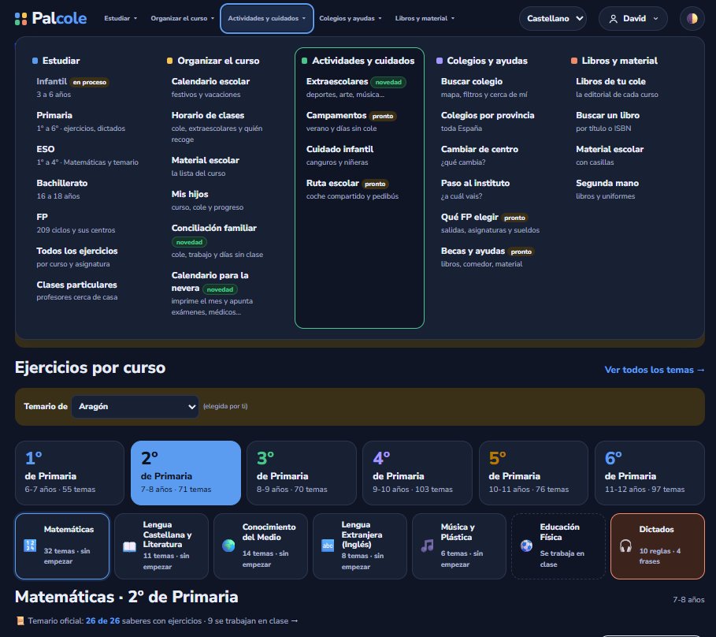

# 🎒 Palcole

**[palcole.es](https://palcole.es)** · Web · 🔒 Private code

> School life for families, in four languages.

## What it does

- **Practice for every school year:** exercises and dictations that change every time, each one linked to the exact line of the official curriculum (BOE and the region's own), with step-by-step solutions. Dictations quote their source, with classic literature for older pupils.
- **Child profiles:** each child has their own year, marks and progress.
- **Kid mode:** hand the tablet to your child, locked with a PIN to their own exercises.
- **Curriculum:** the official curriculum of each region next to the national one.
- **Schools map:** the **13,809 schools in Spain**, with their plots drawn over aerial photos and their after-school activities.
- **Printable worksheets** with the Palcole logo.
- **Fully translated** into Spanish, Catalan, Galician and Basque: interface, exercises, server pages, emails and PDFs.

## Screenshots

**Mobile: an exercise, the official curriculum, the kid-friendly keypad and the step-by-step solution**

  
  
  
  

**Desktop: home, child profiles, exercises by year and menu**

## How it's built

- **Backend:** Python with the standard library only, with SQLite.
- **Open data:** the Ministry of Education's school list, geocoded with CartoCiudad and matched to OpenStreetMap plots. A scheduled container refreshes it every school year.
- **Front end:** vanilla JavaScript, Leaflet and IGN aerial photos.
- **SEO:** real URLs with server-rendered HTML, Open Graph, JSON-LD and a generated sitemap.
- **Anti-scraping:** limits that depend on the type of network a request comes from, escalating bans, and an admin panel.
- **Ops:** Docker, 450+ automated tests and a pentest before every deploy.
