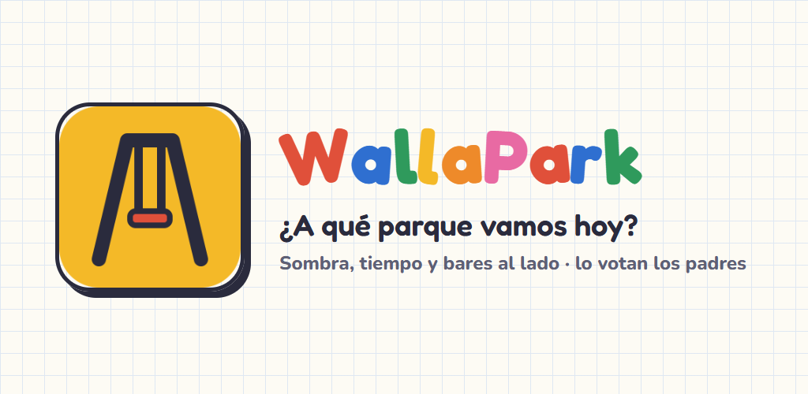
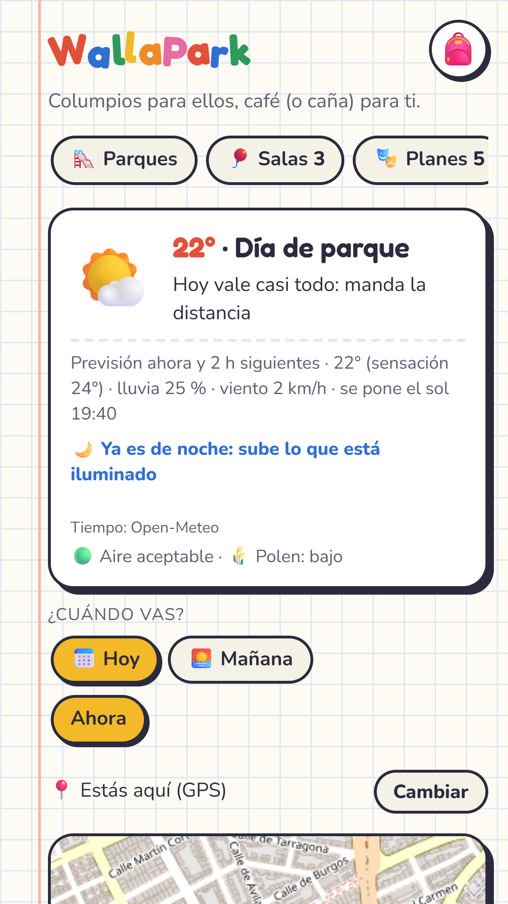
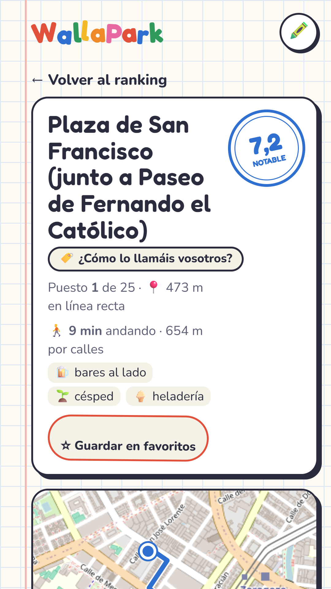
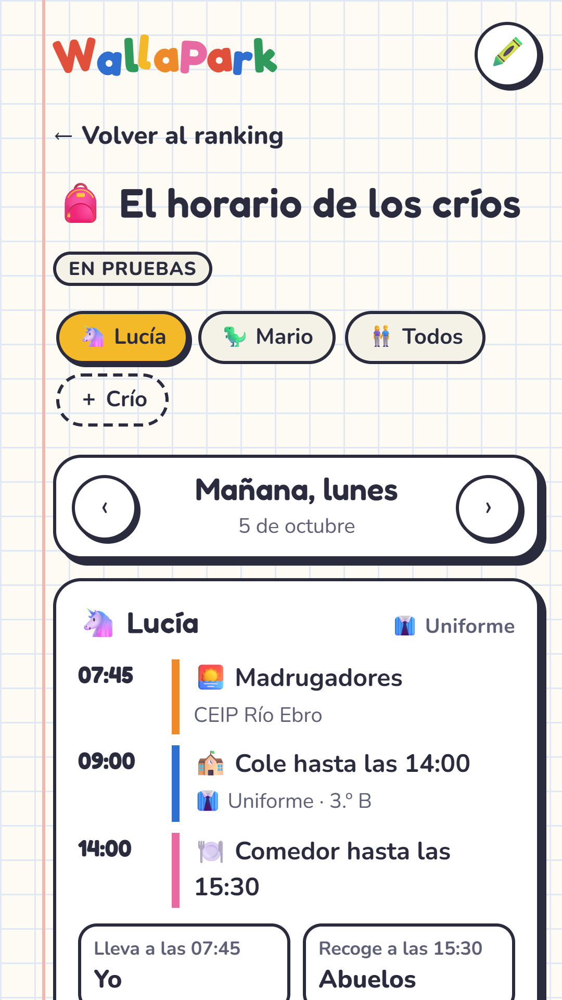

# 🛝 WallaPark

**[wallapark.es](https://wallapark.es)** · Web + Android · 🔒 Private code

> *Columpios para ellos, café (o caña) para ti.* Swings for them, a coffee (or a beer) for you.

## What it does

Parents open the app and get **the nearest playgrounds ranked for right now**:

- **Weather-aware ranking:** on a hot day, shade and water matter most; with wind, sheltered parks go up; at night, only lit ones.
- **What matters to families:** lawn, ice-cream shop, bars next to the park, toilets, fences…
- **Park details:** walking time along real streets, map and amenities.
- **Indoor play centres and plans** for rainy days.
- **Community:** people add missing parks or bars and rate them; photos and comments are moderated.

## Screenshots

  
  
  

## How it's built

- **Backend:** Python with the standard library only, split into layers (pure business rules, repositories, HTTP).
- **Data:** an OpenStreetMap extract of all of Spain plus Overture places, processed into SQLite with a spatial index. A scheduled container rebuilds it every month.
- **Weather:** hourly forecast turned into a "mode" (good / hot / cold / rain / wind) that changes how parks are scored.
- **Front end:** vanilla JavaScript and Leaflet maps, with aerial photos from the Spanish National Geographic Institute (IGN).
- **Ops:** Docker, automated tests with a pentest on every deploy, and moderation with a local LLM (Ollama).
